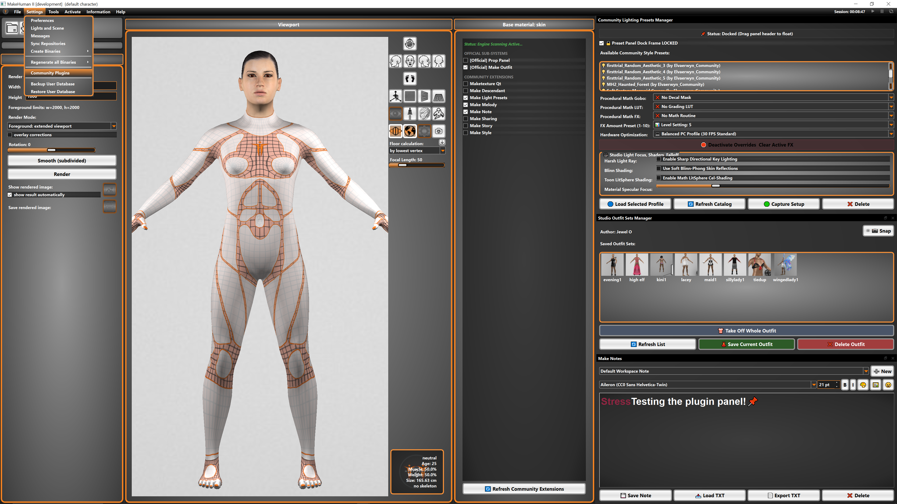
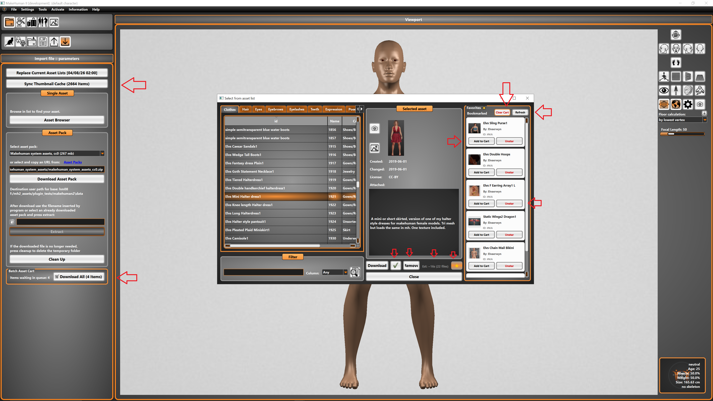

# Official-MH2-Plugins-Release

  
  
The new plugin panel release for Makehuman 2. The Makehuman 2 code-base of the dual purpose plugin/community-extension patch & prop panel 2026 October tentative scheduled release.

This includes fantasy patch, and base legacy mh2, however does not include plugins themselves at present. The official will be added here in due course. The community plugins/addons  
will be uploaded on their own repos Thank you for your understanding!  

This is a work in progress. If you need an officially supported current version of MH2 please grab one from the Makehuman 2 official git.  
Legacy and Fantasy both are available at present,  
    
Elv  
  
Patch Demos:    
    
  

# A basic framework for how to create and implement plugin/exensions in MH2:

In order to have your addon appear in the community plugin panel as a loadable extension there are a few points of consideration.

For basic file structure of your new addon/plugin there will need to be a load and unload script:

- if a large plugin a seperate main.py with def load and def unload extension within it only.
- if a small plugin the def load and def unload shall be at the top of the actual plugin.

For ease of usage and viewport ui streamlining you will need to add docking.

There will need to be an init_ui and within it, be informed which side to hook to.

In order to make your addon sharable, one needs to take the dynamic user folder structure into account at all points.

There needs to be included in the top of the plugin file a list of all outer dependencies not packaged with MH2.

Always put your plugin.py in a folder named exactly what the plugin is(ie; extensions/my_cool_plugin/my_cool_plugin.py.


# Drop in plugin example in extensions(folder structure map):

A plugin can be one .py or an entire software suite, it can be capable of standing alone or ready to drop in only
in this mh2 software(**note this is not the same as the official incorporated style plugins).

 ```
makehuman2/
└── extensions/
├── single_file_preset_mod.py <-- SIMPLE LOOKUP: Just one standalone file dropped in
│
├── large_custom_thing_mod/ <-- COMPLEX PACK: Folder-isolated layout architecture
│ ├── init.py <-- Tells the application boot core to index this pack
│ ├── main.py <-- Core runtime initialization and layout script
│ ├── texture.png <-- Root graphical decal asset file
│ │
│ └── assets/ <-- DYNAMIC DATA CHANNELS
│ ├── stencils/ <-- Target path folder scan channel for stencil masks *example
│ │ └── a_stencil.png
│ ├── grids/ <-- Target path folder scan channel for grading grids *example
│ │ └── random_grid
│ └── lighting_presets/ <-- Automation folder capturing local JSON footprints *example
│ └── the_baseline.json
│
└── cool_thing_mod/ <-- ALTERNATIVE INDEPENDENT PACK

└── main.py <-- Standalone complex engine entry script
 ```

# Official Plugins

The official styled plugins are a little more tricky but can easily be utilized for custom plugin/extensions that are more  
in depth or will need to pull data from the actual software for core functionality.

Many points above are also relevant to create properly loading/working addons in official capacity.

There are a few other important points of consideration:

A .toml is highly suggested for quality hooking.

A seperate init file is highly suggestged for loading.

Make sure to add your plugin name to the mh2_official_tools __init__.py file like so:
 ```
"""
    Official core tools initialization file for MH2
"""
from . import your_cool_plugin
 ```
# Integrated/official plugin example in mh2_official_tools(folder structure map):

A plugin can be one .py or an entire software suite, it can be capable of standing alone or ready to drop in only
**note this is not the same as the drop in extension style plugins).

 ```
makehuman2/
├── pyproject.toml
├── extensions/              <-- (Leave empty for community drop-ins)
└── mh2_official_tools/      <-- Core plugin package
    ├── __init__.py          <-- Main gateway entry point
    ├── tool_alpha.py
    ├── tool_beta.py
    └── Large_cool_tool/     <-- Multi-file tool subfolder
        ├── __init__.py      <-- Sub-tool entry point
        ├── tool_alpha.py
        ├── manifest.toml
        ├── data/
        │   └── resource.json
        └── core/
            └── functional.py
 ```
            
# Advice:

Tip- While making your own plugins you might end up having glitches and corruption, there is a python cache clearing button in mh2 hnow
feel free to make extensive use of this along with deleting the db cache files and .conf file.

Tip- Note that your standalone python tools may also be capable of being a hybrid inside makehuman2. 

Tip- For basic working examples of both types of addon, please see Make note & MH2_asset purge:

 [MH2 Make Note](https://github.com/Licentyius/Make_Note)  
   
 [MH2 Asset Purge](https://github.com/Licentyius/MH2_Asset_Purge)
